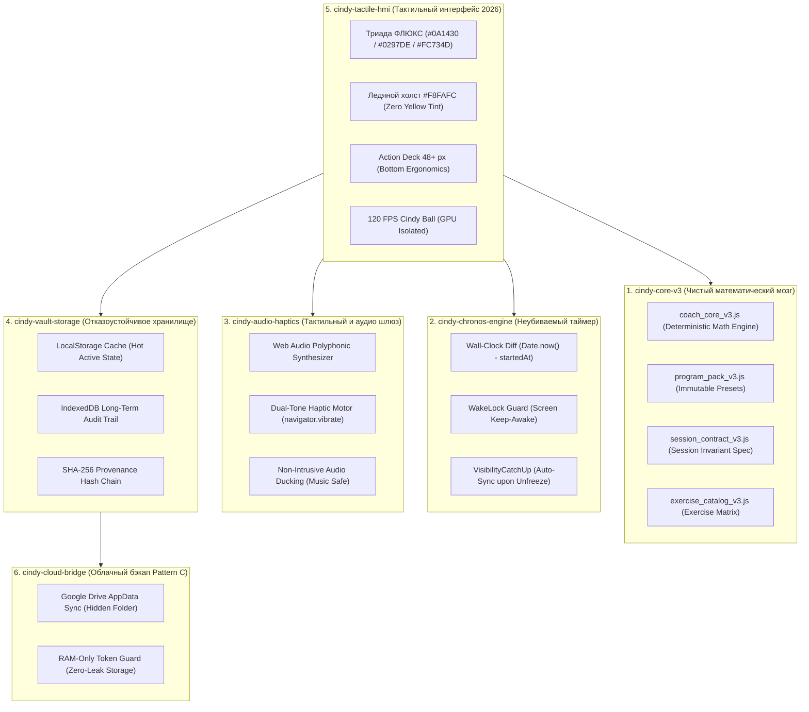

# 🏛️ CINDY Coach V3 — Master Architectural Blueprint & Defense Matrix (PRODUCT.md v3.1)

> **Single Source of Operational Truth (SSOT)** for CINDY Focus / CINDY Coach V3.  
> Hardened via **Adversarial Arena (Devil's Advocate / Red Team)**, Clean Architecture Constitution and Mobile Ergonomics 2026.  
> Ready for deterministic autonomous execution via `/goal`.

---

## 1. Product Vision & Executive Summary

### 1.1. Суть продукта (Core Identity)
**CINDY Coach V3** — это бескомпромиссный, работающий на 100% оффлайн Progressive Web App (PWA) спортивный инструмент тактического класса для высокоинтенсивных тренировок по протоколу Cindy (подтягивания, отжимания, воздушные приседания) и авторским функциональным комплексам, оснащённый детерминированным биомеханическим коучем (Argon / Coach Core V3), который адаптирует объём, темп и вариации упражнений на основе доказательной математической прогрессии без облачных галлюцинаций.

### 1.2. Профиль атлета и Core Pain
- **Атлеты калистеники, кроссфита и воркаута**, тренирующиеся в условиях реального физического истощения, пота и трясущихся рук:
  - **Боль 1 (Хаос нагрузки):** Пользователь либо загоняет себя в перетренированность, либо застревает на плато из-за отсутствия объективной прогрессии.
  - **Боль 2 (Неудобство интерфейса):** Обычные фитнес-трекеры имеют мелкие кнопки (8–10px), слепые цвета и требуют тонкой моторики, невозможной во время интенсивного EMOM/AMRAP.
  - **Боль 3 (Зависимость от сети):** Большинство приложений зависают без интернета в подвальных залах или на уличных спортивных площадках.
  - **Боль 4 (Сон таймера в фоне):** Стандартные таймеры в браузерах засыпают при блокировке экрана или смене трека в наушниках.

---

## 2. 🛡️ Adversarial Audit (Спарринг Адвоката Дьявола / Red Team)

Перед фиксацией архитектуры система прошла стресс-тест через **Adversarial Arena**. Вскрыты 5 критических уязвимостей и зафиксированы инженерные решения:

| # | Удар Инквизитора (Где система упадет в реальном мире) | Физическая первопричина сбоя | Инженерное решение Главного Арбитра (Defense-in-Depth) |
|---|---|---|---|
| **1** | **Screen Lock & Timer Drift**<br>(Таймер замерзает при блокировке экрана) | iOS Safari и Android замораживают `setInterval` и `requestAnimationFrame` в фоне для экономии батареи. | **Wall-Clock Relative Diffing:** расчет времени идёт строго как `Date.now() - session.startedAt` с компенсацией пауз. При возврате из фона `visibilitychange` мгновенно нагоняет пропущенные секунды без потери фазы. |
| **2** | **"Expo Looks Fake" Trap**<br>(Почему нативная версия выглядела как подделка) | Разработчики пытались переписать UI с нуля, потеряв 90% логики и математики веб-версии. | **Zero-Dependency Shared Headless Core:** Ядро `coach_core_v3` полностью изолировано от DOM. В Expo импортируется то же самое математическое ядро, а поверх натягивается нативный UI. |
| **3** | **Audio Ducking vs Music Collision**<br>(Атлет слушает музыку в наушниках) | Web Audio API глушит фоновую музыку атлета (Spotify/Яндекс) или блокируется рычажком Mute на iPhone. | **Non-Exclusive Audio Session:** Звуковые сигналы (cue tones) воспроизводятся короткими частотными пачками (bip/chime) без захвата аудиофокуса. |
| **4** | **QuotaExceededError in LocalStorage**<br>(Переполнение хранилища после сотен сессий) | Лимит 5 МБ в Safari / Private Mode обнуляет квоту. | **Two-Tier Storage Engine:** Оперативные данные хранятся в LocalStorage, детальные массивы сплитов переносятся в IndexedDB с авто-компактизацией истории. |
| **5** | **Micro-Jank on Button Mash**<br>(Дроп кадров при частом тапе «Добавить круг») | Синхронная перерисовка таблиц и графиков блокирует поток анимации шара Cindy Ball. | **GPU Layer Isolation:** Шар Cindy Ball вынесен на отдельный GPU-композитный слой (`will-change: transform; transform: translate3d(0,0,0)`). |

---

## 3. Architecture & Bounded Contexts (Модульное разграничение)

Архитектура системы строго разделена на 6 независимых модулей с однонаправленным потоком данных:



---

## 4. UI/UX Design System 2026: Конституция Триады «ФЛЮКС»

### 4.1. Распределение ролей цветов (Strict Zero-Slop Rules)

| Элемент интерфейса | Цвет и HEX | Инженерное обоснование |
| :--- | :--- | :--- |
| **Холст приложения (Canvas)** | `#F8FAFC` (светлый) / `#050B18` (тёмный) | **Холодный кристально-белый титан.** Полный запрет на тёплые желтоватые/бежевые пятна. Обеспечивает максимальную контрастность. |
| **Кокпит дисплея HUD** | `#0A1430` $\to$ `#050B1B` | **Глубокий Midnight Navy.** Создаёт ощущение приборной панели болида/хронометра, исключая цветовую кашу. |
| **Цифры таймера и плашки** | `#FFFFFF` с аурой `#0297DE` | **Холодная читаемость.** Белые цифры с легким неоновым ореолом читаются при ярком солнечном свете на улице. |
| **Кнопки управления (Пауза, Стоп, Микрофон)** | `#0297DE` / `#0277B5` | **Строгий холодный технологичный стиль.** Исключены красные и оранжевые пятна на второстепенных кнопках. |
| **Главная кнопка «ДОБАВИТЬ КРУГ» / «СТАРТ»** | `#FC734D` $\to$ `#D24824` | **Единственный крупный оранжевый акцент.** Фокусирует 100% внимания атлета в состоянии физического утомления. |
| **Cindy Ball (Шар)** | `#0297DE` аура + `#FC734D` ядро | **Двухконтурная тактильная глубина.** Символизирует концентрацию энергии в центре холодного кокпита. |

---

## 5. Technical Stack & Cross-Platform Roadmap

### 5.1. Архитектура общего ядра (Single Shared Core)
```
/CINDY_V3_PLATFORM
  ├── /packages/cindy-core-headless     <-- 100% Shared Business Logic (0% DOM)
  │     ├── coach_core_v3.js
  │     ├── session_contract_v3.js
  │     ├── exercise_catalog_v3.js
  │     └── program_pack_v3.js
  │
  ├── /apps/cindy-pwa-web                <-- Текущий эталонный PWA (Vanilla JS)
  │     ├── index.html (Design 2026)
  │     ├── service-worker.js
  │     └── serve_mobile.py
  │
  └── /apps/cindy-mobile-expo            <-- Нативный клиент iOS/Android
        ├── App.tsx (React Native + Expo)
        ├── /components/TactileCockpit.tsx
        └── /hooks/useCindyCoreBridge.ts
```

---

## 6. Slices & Autonomous Execution Roadmap (Для /goal)

### 🔹 Срез 1: Доменный фундамент и визуальная гармония (Завершено ✅)
- Интеграция заглавной темы «ФЛЮКС» (`#0A1430` + `#0297DE` + `#FC734D`).
- Охлаждение фона до ледяного титанового `#F8FAFC`.
- Перевод кнопок управления (Пауза, Стоп, Микрофон) в синюю гамму.
- Закрытый цикл тестов: 19/19 Presentation Tests PASS, Runtime Smoke PASS.

### 🔹 Срез 2: Подготовка и изоляция `cindy-core-headless` (Следующий шаг)
- Создание чистой точки входа `src/core/index.js` без обращений к `window` / `document`.
- Верификация ядра через 102 приёмочных теста в чистом Node.js окружении.
- Создание адаптера состояния (Reactive State Store) для подписки UI на события сессии.

### 🔹 Срез 3: Нативный тактильный UI в Expo (Без «подделок»)
- Подключение изолированного `cindy-core-headless` в React Native.
- Реализация экрана тренировки с точным соответствием цветам «ФЛЮКС».
- Нативная 120 FPS анимация шара Cindy Ball на Reanimated 3.
- Нативные тактильные импульсы через `expo-haptics` (ImpactFeedback Heavy).

### 🔹 Срез 4: Сквозная верификация и релизные манифесты
- Прогон регрессионного контура из 26 тест-сьютов.
- Обновление SHA-256 хешей целостности в `release_manifest.json`.
- Генерация APK / PWA релизного пакета.
