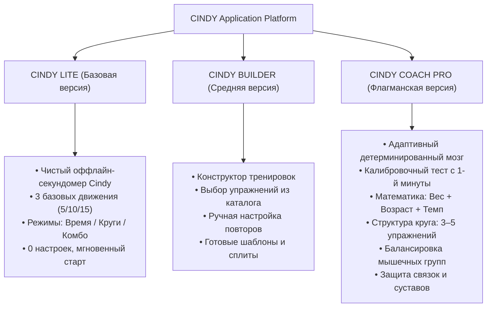

# CINDY / CINDY Coach V3 — Комплексное продуктовое досье и дорожная карта разработки (Product Blueprint & Roadmap)

**Версия документа:** 3.1.0-PRO  
**Статус:** Утверждён к реализации  
**Роли:** CPO / Lead System Architect / Sports Science Lead / Lead Frontend / UI-UX Lead / QA Lead  
**Проект:** CINDY PWA (Cindy Benchmark, Calisthenics Adaptive Engine)  
**Рабочая директория:** `c:\Users\Геннадий\Downloads\CINDY_CoachV3_source_04-10-2026`  

---

## 1. Продуктовая стратегия и разделение линеек (Product & Business Strategy)

### 1.1. Проблема рынка и Core Pain
Большинство таймеров для калистеники и кроссфита — «тупые секундомеры» со статичным звуковым сигналом. Приложения с «ИИ-тренерами» грешат двумя крайностями:
1. **Галлюцинирующие LLM:** генерируют случайные тренировки без учета накопительной усталости и биомеханики.
2. **Мёртворождённая бюрократия (опыт Manus/ChatGPT):** алгоритм заблокирован сотнями параноидальных условий («сделайте ещё 3 тренировки вслепую»), а вес и возраст объявлены «контекстом без математического влияния». Атлет не видит изменений и бросает продукт.

### 1.2. Архитектура трёх редакций продукта



---

## 2. Алгоритмическое ядро тренера Coach Pro (Sports Science & Algorithmic Engine)

### 2.1. Формула калибровочного теста (Day 1 / Baseline Calibration)
Пользователь проходит контрольный тест Cindy (5, 10 или 20 минут в режиме AMRAP). Алгоритм не ждёт 3 тренировки, а мгновенно рассчитывает паспорт атлета:

$$\text{Pace Index (Темп)} = \frac{\text{Завершённые круги}}{\text{Минуты теста}}$$

$$\text{Fatigue Drop (Коэффициент закисления)} = \frac{\text{Медиана времени последних 20\% кругов}}{\text{Медиана времени первых 20\% кругов}}$$

* $\text{Fatigue Drop} \le 1.15$: **Стабильный темп** (высокая аэробная/силовая выносливость). Готов к росту объёма.
* $\text{Fatigue Drop} > 1.35$: **Быстрое закисление** (ЦНС и мышцы перегружены). Требуется снижение повторений в круге для сохранения плотности.

### 2.2. Биомеханика массы тела (Относительная сила)
В калистенике вес тела атлета ($M$) — это рабочий вес на штанге.
* **Подтягивания (Pull):** Нагрузка на сухожилия бицепса и широчайших пропорциональна $M^{1.0}$. При весе $\ge 85$ кг или повышенном ИМТ базовые 5 висячих подтягиваний перегружают связки локтя.
* **Правило тренера:**
  * Если $M \ge 85\text{ кг}$ и $\text{Pace Index} < 0.7$ $\rightarrow$ Замена варианта на `pull_assisted_band` (резина) или `pull_row_inverted` (австралийские), либо снижение до 2–3 повторов.
  * Если $M < 72\text{ кг}$ и результат теста сильный $\rightarrow$ Подтягивания остаются чистыми (5 повторов) или усложняются хватом.

### 2.3. Возрастной коэффициент восстановления (Age & Recovery Factor)
* **Возраст $\le 30$ лет:** коэффициент восстановления $K_{\text{rec}} = 1.0$. Быстрая адаптация, допустим шаг $+1$ повтор при стабильных сессиях.
* **Возраст $31–45$ лет:** $K_{\text{rec}} = 0.85$. Шаг объёма даётся через сессию; окно между тяжёлыми сессиями одной группы $\ge 48$ часов.
* **Возраст $46+$ лет:** $K_{\text{rec}} = 0.70$. Приоритет безопасности суставов. Прогрессия идёт за счёт качества и пауз, а не накрутки повторов.

### 2.4. Динамическая структура круга (3–5 упражнений)
Тренер имеет полномочия варьировать состав раунда:
1. **Слот 1 (Тяга / Спина):** `pull_pronated` / `pull_supinated` / `pull_assisted_band` / `pull_row_inverted`.
2. **Слот 2 (Жим / Грудь / Плечи):** `push_classic` / `push_knee` / `push_incline` / `push_narrow`.
3. **Слот 3 (Ноги / Квадрицепс / Ягодицы):** `squat_classic` / `squat_pause` / `squat_reverse_lunge`.
4. **Слот 4 (Опционально — Мышцы кора / Пресс):** `abs_controlled_curlup` / `abs_hanging_knee_raise` — подключается при простаивании кора.
5. **Слот 5 (Опционально — Брусья / Трицепс):** `push_parallel_bar_dip` / `push_bench_dip` — подключается для атлетов с запасом мощности.

---

## 3. Архитектура программного обеспечения (Clean Architecture AS-IS $\rightarrow$ TO-BE)

```
cindy_coach_v3/
├── index.html                           # Root Presentation Shell (CSS Tokens, Screen Hosts, Markup)
├── coach_core_v3/
│   ├── coach_core_v3.js                 # Чистый детерминированный движок решений (Математика + Физиология)
│   ├── coach_integration_v3.js          # Адаптер ядра к рантайму браузера
│   └── program_pack_v3.js               # Базовые шаблоны ротаций
├── src/
│   ├── domain/                          # ЧИСТАЯ БИЗНЕС-ЛОГИКА (Без DOM, без внешних библиотек)
│   │   ├── exercises/exercise_catalog_v3.js   # Каталог упражнений, прогрессий и мышечных профилей
│   │   ├── workout/session_contract_v3.js     # Иммутабельный контракт сессии (freeze/sanitize/apply)
│   │   └── history/history_provenance_v3.js   # Достоверность истории и происхождение данных
│   ├── application/                      # СЦЕНАРИИ ИСПОЛЬЗОВАНИЯ (Use Cases)
│   │   ├── coach/coach_application_service_v3.js # Оркестрация решений тренера, Starter Phase
│   │   ├── program/program_service_v3.js         # Управление сменой дней и циклов
│   │   └── workout/workout_history_service_v3.js # Агрегация и статистика тренировок
│   ├── infrastructure/                  # ИНФРАСТРУКТУРА И ХРАНИЛИЩЕ
│   │   ├── storage/local_storage_v3.js           # Оффлайн-хранилище LocalStorage с защитой схем
│   │   ├── storage/coach_state_repository_v3.js  # Стейт тренера
│   │   └── browser/feedback_v3.js                # Тактильный и звуковой движок (Web Audio, Haptic)
│   └── presentation/                    # СЛОЙ ПРЕДСТАВЛЕНИЯ
│       ├── navigation/screen_router_v3.js        # Маршрутизация экранов (Workout, Programs, Profile)
│       └── components/leaf_components_v3.js      # Атомарные UI-компоненты
└── tests/                               # АВТОМАТИЗИРОВАННЫЙ ТЕСТОВЫЙ КАРКАС (26 сценариев)
```

### Архитектурные инварианты (Защита от деградации):
1. **Zero External Build Step:** Никаких `npm run build`, Webpack или Vite. Браузер исполняет код напрямую.
2. **Deterministic Coach Core:** Никаких скрытых `Math.random()` или внешних запросов. При одинаковой истории и параметрах тренер всегда выдаёт идентичное решение.
3. **Session Contract Immutability:** Изменение состава тренировки происходит только через фасад `apply()`, исключая рассинхронизацию интерфейса.

---

## 4. UI/UX 2026: Тактильный спортивный кокпит (Tactile Cockpit Design)

```
+-------------------------------------------------------------+
|  [≡] CINDY / COACH PRO                      (Тема)  [⚙]     |
+-------------------------------------------------------------+
|                                                             |
|   +-----------------------------------------------------+   |
|   |  ВАШ ТРЕНЕР · СЛЕДУЮЩАЯ ТРЕНИРОВКА                  |   |
|   |  По результату теста и весу (82 кг):                |   |
|   |  • Подтягивания: 5 повторов                         |   |
|   |  • Отжимания: +1 повтор (11 повт.)                  |   |
|   |  • Приседания: 15 повторов                          |   |
|   |  • Добавлен Кор: Скручивания (10 повт.)             |   |
|   |                                                     |   |
|   |            [ ПРИМЕНИТЬ РЕКОМЕНДАЦИЮ ]               |   |
|   +-----------------------------------------------------+   |
|                                                             |
|   +-----------------------------------------------------+   |
|   |                     20:00                           |   |
|   |                   0 КРУГОВ                          |   |
|   |      5 подт. · 11 отж. · 15 прис. · 10 пресс        |   |
|   +-----------------------------------------------------+   |
|                                                             |
|   [================= ДОБАВИТЬ КРУГ =================]   |
|   [     ПАУЗА     ]               [    ЗАВЕРШИТЬ    ]   |
|                                                             |
+-------------------------------------------------------------+
|  [Тренировка]     [Планы/Тренер]    [Прогресс]    [Профиль] |
+-------------------------------------------------------------+
```

* **Thumb-Zone эргономика:** Главная кнопка фиксации круга имеет высоту $\ge 64$px и расположена в нижней трети экрана для безошибочного нажатия в поту и на ходу.
* **Physical Haptic Feedback:** Чёткая тактильная вибрация при отсечке круга (не нужно смотреть на экран).
* **Прозрачность решений:** Тренер не просто молча меняет цифры, а пишет человеческое обоснование («почему»).

---

## 5. Дорожная карта разработки по спринтам (Sprint Roadmap)

| Спринт | Фокус | Задачи | Критерий готовности (Definition of Done) |
|---|---|---|---|
| **Sprint 0** | Стабилизация фундамента | Аудит модулей, устранение time-drift, фикс владения `COACH` vs `BUILDER`, XSS-санитизация модальных окон. | 26/26 тестов проходят, хеши целостности зелёные. *(Завершено)* |
| **Sprint 1** | Математический мозг ядра (`coach_core_v3.js`) | Внедрение формул относительной силы (вес/рост), возрастного фактора восстановления, расчёт Starter-шага сразу после теста, логика 3–5 упражнений. | Acceptance тесты ядра (102 кейса) расширены проверками веса/возраста и дают 100% PASS. |
| **Sprint 2** | Сквозная связка UI и тренера | Вывод разбора теста на экране результатов, прозрачная карточка «Ваш тренер» с кнопкой «Применить», мгновенная смена состава на экране таймера. | Тест в браузере: прошёл калибровку $\rightarrow$ нажал «Применить» $\rightarrow$ таймер готов с новыми упражнениями. |
| **Sprint 3** | Баланс мышц и ротация вариантов | Анализ истории на предмет простаивающих зон (кор, трицепс), включение 4-го и 5-го упражнения в круг, ступени прогрессии/регрессии. | При отсутствии упражнений на пресс в последних 3 днях тренер аргументированно добавляет `abs`. |
| **Sprint 4** | Разделение версий (Lite / Builder / Pro) | Чистый селектор режима в интерфейсе: возможность запуска Cindy как обычного секундомера без тренера или в режиме флагманского коуча. | Переключение между «Классика / Про / Коуч» не сбрасывает историю и меняет сложность интерфейса. |
| **Sprint 5** | Финальный E2E QA и релиз | Регрессионный прогон, валидация оффлайн Service Worker PWA на мобильных экранах, аудит производительности (Lighthouse). | 100% готовность к эксплуатации, чистый отчет валидации. |

---

## 6. Резюме для команды
Разработка переведена из режима хаотичных экспериментов в строгий инженерный пайплайн. Архитектура готова к реализации **Спринта 1** (наполнение математического ядра тренера живой физиологией калистеники).
